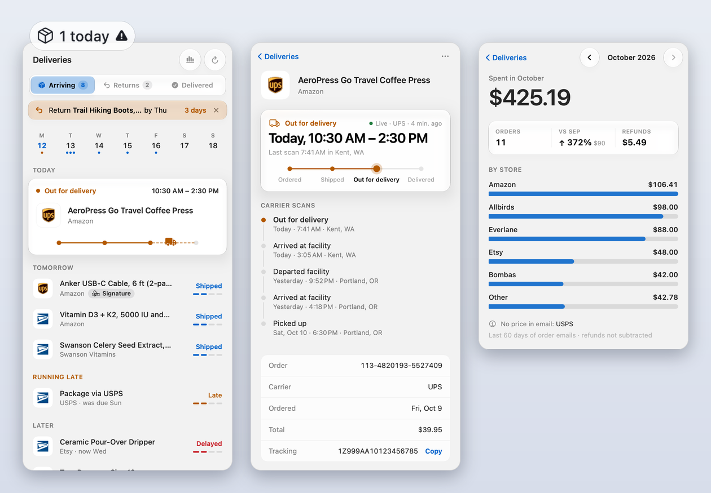
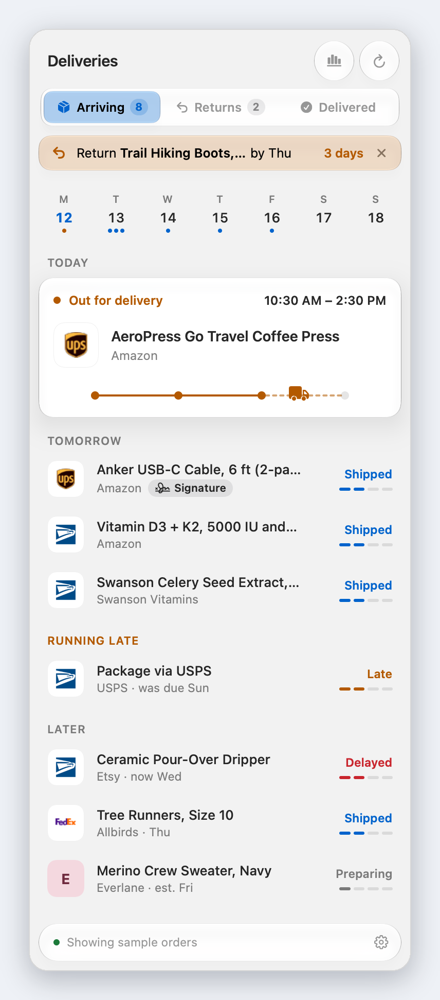
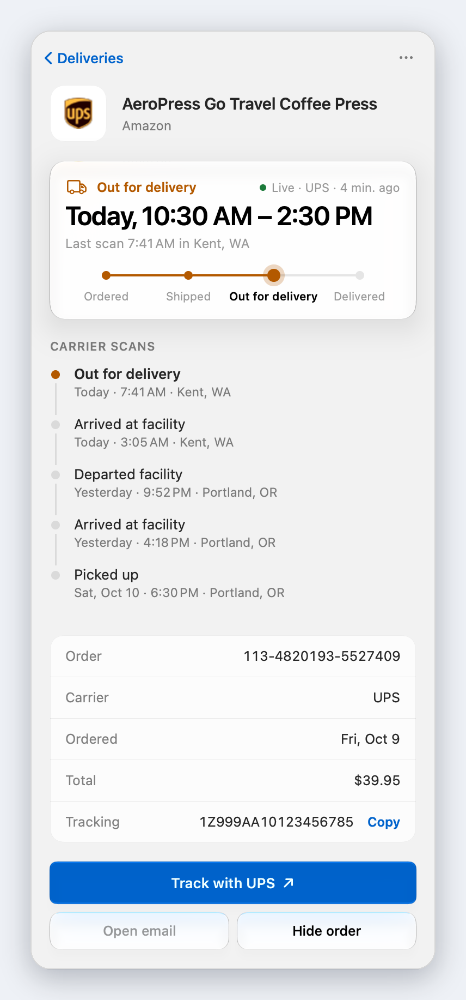
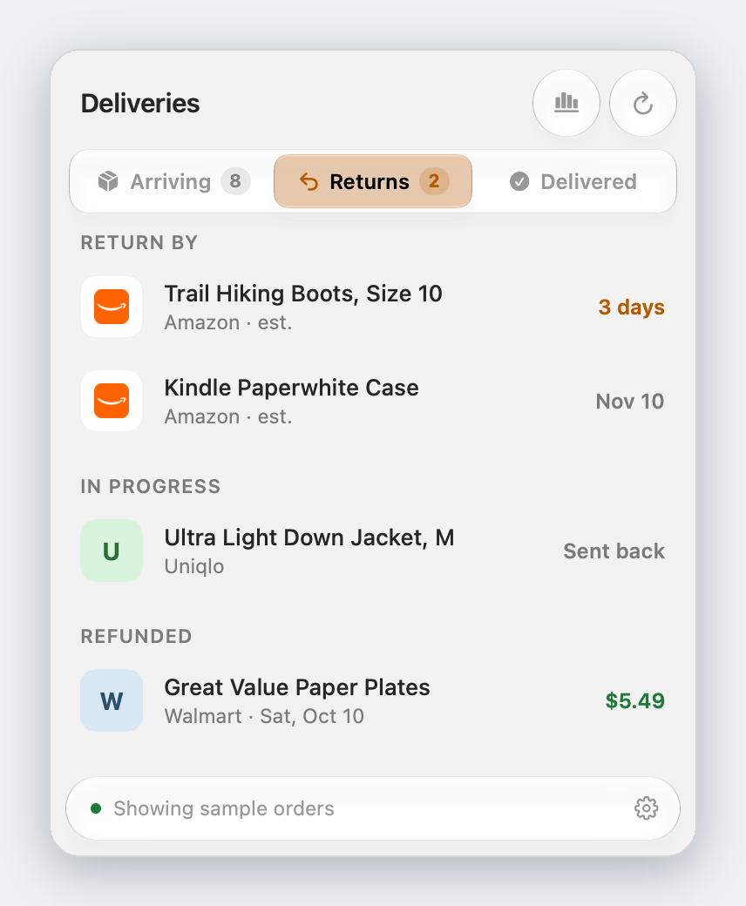
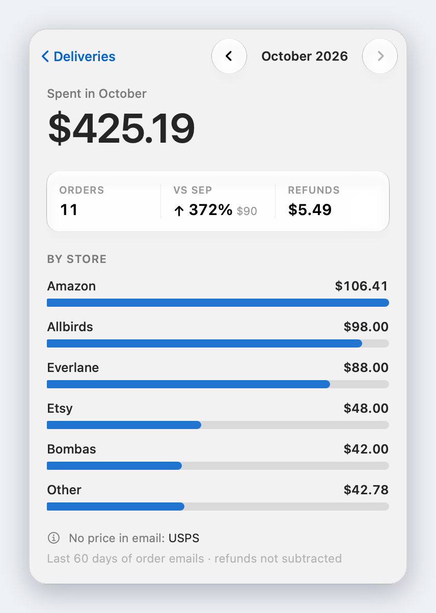
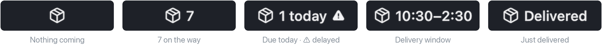

# Doorstep

**Every package, one glance.** A macOS menu bar app that turns the shipping emails in your Gmail
into a calm, live list of what's arriving, what to return, and what you've spent. Everything is
read on your Mac; nothing goes to a server but Gmail and (optionally) the carriers themselves.

<p align="center">
  
</p>

<sub>Screenshots use the app's built-in sample orders, in light mode. Sections, cards and reminders
appear only when you have something for them, so your panel will usually be shorter.</sub>

## A quick tour

<table>
<tr>
<td width="50%" valign="top">

### Arriving
Packages grouped by **Today**, **Tomorrow**, **Running late** and **Later**, each with a colored
status (Shipped, Arriving today, Out for delivery, Delayed, Late, Preparing) and a 4-step progress
bar. A package that's out for delivery gets its own card with the delivery window and a little
truck on the last stretch. The **week strip** above shows a dot for each day with deliveries; click
a day to see just that day. When a return window closes within 3 days, a one-line reminder
appears at the top (dismiss it with ✕; it stays on the Returns tab).

</td>
<td width="50%" valign="top">

</td>
</tr>
<tr>
<td width="50%" valign="top">

</td>
<td width="50%" valign="top">

### Every order, in detail
The current status in plain words ("Today, 10:30 AM – 2:30 PM"), the full timeline, order
number, total and tracking number with one-click copy. With **live carrier tracking** on, the
timeline becomes every scan from UPS, USPS, FedEx or DHL, with the city it happened in and a small
map of the last scan.

</td>
</tr>
<tr>
<td width="50%" valign="top">

### Returns
Return deadlines for delivered orders (stated in the email, or the store's usual window, marked
*est.*), returns in progress (started → sent back → received → refunded), and refunds, including
the small ones for unavailable grocery items. You get a notification 3 days before a window closes.

</td>
<td width="50%" valign="top">

</td>
</tr>
<tr>
<td width="50%" valign="top">

</td>
<td width="50%" valign="top">

### Spending
What you spent each month, by store, from the order totals in your email, plus the change from
last month and refunds. Stores whose emails carry no price (a carrier's shipping notice only) are
named, so a low month never looks mysterious.

</td>
</tr>
</table>

### In the menu bar

<p align="center">
  
</p>

The box hops when a package goes out for delivery and wiggles when one is delivered.
"Delivery window" needs live tracking; "Just delivered" shows for an hour.

### Also

- **Signature required** badge when someone needs to be home.
- **Product photos** from the email; otherwise a category icon, the store's logo or the carrier's.
- **Paste to track:** copy any UPS/USPS/FedEx/DHL number, open the panel on Arriving or Returns, press ⌘V.
- **Right-click any order:** copy tracking number, track, open the email, mark as received, hide.
- **Searchable history** of everything delivered in the last 60 days.
- **Notifications** only when it matters: out for delivery, delivered, delayed, return window closing.
- Liquid Glass controls, light and dark mode, and Reduce Motion respected.

| Shortcut | Action |
| --- | --- |
| ⌥⌘D | Open or close Doorstep from anywhere |
| ⌘1 / ⌘2 / ⌘3 | Arriving / Returns / Delivered |
| ↑ ↓ then ↩ | Move through orders and open one; Esc goes back |
| ⌘R | Refresh |
| ⌘V | Track a copied tracking number (Arriving and Returns tabs) |

### Limitations

Doorstep only knows what your email (and, if connected, the carrier) says:

- **Amazon** emails name only a category ("Supplements"), never the product or a photo, and
  Amazon doesn't email "Out for delivery". Amazon packages due today show **Arriving today**;
  their `TBA…` tracking numbers can't be checked with any carrier.
- **Spending** counts only orders whose emails include a price. Stores you only hear about
  through a carrier's shipping notice (e.g. "Your UPS package was delivered") aren't counted, and
  are named under the chart.
- **Return windows** marked *est.* use the store's usual policy (Amazon 30 days, Walmart and
  Target 90, …), not your specific item's.
- Without live tracking, status updates only when the store sends an email; if no "delivered"
  email comes, an order is shown as **Likely delivered** a few days after its expected date.
- Gmail only, last 60 days.

### Privacy

- **Gmail access is read-only.** Doorstep can't send, delete or change email.
- **Order details are extracted on your Mac,** using schema.org markup, text patterns and Apple's
  on-device Foundation Models. Emails are never uploaded anywhere.
- **Live tracking is optional,** and sends only tracking numbers, to the carriers you connect.
- Credentials live in the macOS Keychain; cached orders live in `~/Library/Application Support/Doorstep`.

## Build and run

Requires macOS 26+ and the Xcode Command Line Tools (full Xcode not needed).

```sh
scripts/build-app.sh            # builds build/Doorstep.app
scripts/build-app.sh --install  # also copies to ~/Applications and launches it
```

Without Gmail connected, choose **Preview with sample orders** to try the UI.

**Stop Keychain prompts after rebuilds (one-time):** `scripts/make-signing-cert.sh` creates a local
"Doorstep Local Signing" identity in your login keychain; `build-app.sh` uses it automatically so
every build keeps the same signature. Click **Always Allow** once after switching.

## Connect Gmail (one-time, about 5 minutes)

Google only lets an app read Gmail through a sign-in you create in your own Google account. It's
free, nobody else uses it, and you do it once. Doorstep walks you through it:

1. Open the panel and click **Set up Gmail**. A checklist lists the five Google Cloud steps; each
   **Open** button goes straight to the right page, with a one-line hint of what to click.
2. After the last step (**Download JSON**), Doorstep spots the `client_secret_….json` in your
   Downloads and offers to use it. You can also **Choose…** it or drop it on the panel. The file is
   checked right away (for example, it tells you if you made a *Web* client instead of *Desktop app*).
3. Click **Connect Gmail**, choose **Continue** on Google's "unverified app" notice (expected for
   an app only you use), and approve **read-only** access. If macOS asks about the Keychain, choose
   **Always Allow**.

The first sync reads the last 60 days of order emails and takes a few minutes.

**Staying signed in.** While your Google app is in *Testing*, Google signs you out every 7 days.
After you connect, Doorstep shows a one-time tip with links: fill in **Branding** (app name, support
and developer emails; leave the logo empty, which would trigger Google's review), then **Publish app**
on the **Audience** page. If Google does sign you out, the panel says so and offers **Reconnect Gmail**.

<details>
<summary>The same steps, without the in-app guide</summary>

**1. Create a project.** <https://console.cloud.google.com/projectcreate>
Name it anything (e.g. "Doorstep") → **Create**. Make sure it's selected in the project picker at
the top left before continuing.

**2. Turn on the Gmail API.** <https://console.cloud.google.com/apis/library/gmail.googleapis.com>
Click **Enable**. (If it says **Manage**, it's already on.)

**3. Set up the sign-in screen.** <https://console.cloud.google.com/auth/overview> → **Get started**
- **App Information:** app name "Doorstep", and your email as the support email.
- **Audience:** choose **External**. (*Internal* is greyed out unless you use Google Workspace.)
- **Contact Information:** your email.
- **Finish:** agree to the policy → **Create**.

**4. Add yourself as a test user.** <https://console.cloud.google.com/auth/audience>
Under **Test users** → **Add users** → your Gmail address → **Save**.

**5. Create the Desktop client.** <https://console.cloud.google.com/auth/clients> → **Create client**
- Application type: **Desktop app**. Name: anything.
- Leave "Use this client for an AI-powered agent" unchecked.
- **Create**, then **Download JSON** in the dialog that appears.

**6. Give the file to Doorstep.** Move the downloaded `client_secret_….json` to
`~/Library/Application Support/Doorstep/client_secret.json` (in Finder: **Go → Go to Folder…**),
or run:

```sh
mv ~/Downloads/client_secret_*.json ~/Library/Application\ Support/Doorstep/client_secret.json
```

Then quit and reopen Doorstep.

**7. Connect.** Click **Connect Gmail** in the panel. Your browser opens Google's sign-in:
- "Google hasn't verified this app" is expected for an app only you use → **Continue**.
- Approve **read-only** access. The browser then says *Doorstep is connected*.
- macOS may ask whether Doorstep can use its Keychain item → **Always Allow**.

The first sync reads the last 60 days of order emails and takes a few minutes; the list fills in
as it goes.

**Staying signed in (recommended).** While the app is in *Testing*, Google signs you out every
7 days. To stop that:
1. Open <https://console.cloud.google.com/auth/branding> and make sure app name, user support
   email and developer contact email are filled in. **Leave the logo empty**, since adding one
   triggers Google's review.
2. Open <https://console.cloud.google.com/auth/audience> → **Publish app**. (It stays greyed out
   until Branding is complete.) No verification is needed for an app only you use.

</details>

**If something goes wrong**

| You see | What it means |
| --- | --- |
| The client file is rejected | It's not a *Desktop app* client, or it's incomplete; create or download it again (step 5) |
| "Access blocked: Doorstep has not completed the Google verification process" | Your Gmail address isn't in **Test users** (step 4) |
| Error mentioning `redirect_uri` or a *Web* client | The client type must be **Desktop app** (step 5) |
| "Google signed you out" after about a week | The app is still in *Testing*; click **Reconnect Gmail**, then publish it (above) |
| Repeated Keychain password prompts | Choose **Always Allow**, not Allow; see *Build and run* for the signing tip |

## Live carrier tracking (optional)

Doorstep asks the carriers directly, with free official developer credentials. **Every carrier is
optional:** connect only the ones you get packages from; the rest keep tracking from email.

| Carrier | Where to get free credentials | What to paste in Settings |
| --- | --- | --- |
| UPS | <https://developer.ups.com> → create an app with the **Tracking** API | Client ID + Client secret |
| USPS | <https://developers.usps.com> → create an app (includes **Tracking**) | Consumer key + Consumer secret |
| FedEx | <https://developer.fedex.com> → create a project with the **Track API** | API key + Secret key |
| DHL | <https://developer.dhl.com> → **Shipment Tracking – Unified** | API key |

In Doorstep: **Settings → Live tracking → Connect** next to a carrier. Credentials are checked
when you save and stored in Keychain.

For carriers without official credentials, an optional [17TRACK](https://api.17track.net) key
covers almost everything else (200 free tracking numbers on new accounts).

Active packages are checked every 30 minutes (10 while out for delivery). Carrier data overrides
email when it's newer. Amazon's own `TBA…` numbers and grocery deliveries can't be tracked outside
the store, so they stay email-only.

## How it works

| Piece | File |
| --- | --- |
| OAuth (loopback + PKCE), token in Keychain | `Sources/Doorstep/Gmail/GoogleAuth.swift` |
| Gmail search + message fetch | `Sources/Doorstep/Gmail/GmailClient.swift` |
| schema.org `Order`/`ParcelDelivery` markup | `Sources/Doorstep/Parsing/SchemaOrgParser.swift` |
| Patterns: status, tracking & order numbers, dates | `Sources/Doorstep/Parsing/Heuristics.swift` |
| On-device model (Foundation Models) | `Sources/Doorstep/Parsing/AIExtractor.swift` |
| Merging emails into orders | `Sources/Doorstep/Parsing/OrderBuilder.swift` |
| State, sync, notifications, spending | `Sources/Doorstep/Model/OrderStore.swift` |
| UPS, USPS, FedEx, DHL clients | `Sources/Doorstep/Gmail/CarrierTrackers.swift` |
| 17TRACK client (fallback) | `Sources/Doorstep/Gmail/TrackingService.swift` |
| Returns and return windows | `Sources/Doorstep/Model/Returns.swift` |

**Thumbnails**, in order of preference: the product photo from the email → a category icon when
the email names only a category (Amazon) → the store's logo → the carrier's logo → the store's
initial. Photos and logos are downloaded once and kept in `~/Library/Application Support/Doorstep/images`.
Logos come from the site's own app icon or DuckDuckGo's icon service.

Gmail (last 60 days) is checked every 15 minutes and on wake. Each email is parsed once and cached in
`~/Library/Application Support/Doorstep/state.json`.

## Tests

```sh
SDKROOT=$(ls -d /Library/Developer/CommandLineTools/SDKs/MacOSX26.*.sdk | tail -1) \
  swift test -Xswiftc -plugin-path -Xswiftc /Library/Developer/CommandLineTools/usr/lib/swift/host/plugins/testing
```

The on-device model tests skip automatically where Apple Intelligence is off.

## Layout snapshots

```sh
build/Doorstep.app/Contents/MacOS/Doorstep --snapshot /tmp/doorstep-snaps
```

Renders every screen (light and dark) with sample data to PNGs; the README images come from these.

Debugging the parser:
- `Doorstep --search "<gmail query>"` lists matching emails (id, sender, subject).
- `Doorstep --dump <gmail message id>` prints the text and images the parser sees for one email.
